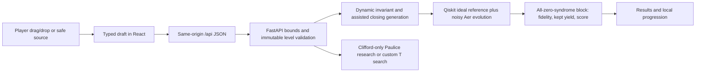

# Submission information — Schrodinger's Hackers

This is a factual collection and planning aid, **not the team's final report, narration, slides, or recorded presentation**. Snapshot: 16 October 2026; local base commit `04182c2`, plus the menu credits and this document. Recheck the final branch and artifacts before submission. `Done` means the stated evidence exists; it does not certify eligibility, judging scores, or submission acceptance. `Needs us` means team action is required. `Unknown` means **Unconfirmed** by the supplied sources.

## Contents

- [Sources and track identification](#sources-and-track-identification)
- [A. Submission checklist](#a-submission-checklist)
- [B. Deadline and repository readiness](#b-deadline-and-repository-readiness)
- [C. Project facts for the report](#c-project-facts-for-the-report)
- [D. Libraries, tools, and published-method credits](#d-libraries-tools-and-published-method-credits)
- [E. AI-use disclosure material](#e-ai-use-disclosure-material)
- [F. Report and video planning aids](#f-report-and-video-planning-aids)
- [G. Open questions and team-supplied material](#g-open-questions-and-team-supplied-material)

## Sources and track identification

| Source | What it establishes |
|---|---|
| [Repository track brief](<Qiskit Fall Fest 2026 Hackathon - Advanced Track.pdf>), five pages | Page 1 explicitly identifies **Advanced Track**, a game about low-overhead spacetime error detection; Basic is a different geometry-aware challenge. Pages 2–3 specify tooling, physics and experiments; pages 4–5 specify submissions and judging. |
| Brief SHA-256 | `81d9e22329453f1330530924dbf057a0495194c067e77ff37967fba88b02f7d2`; reproduce with `Get-FileHash 'Qiskit Fall Fest 2026 Hackathon - Advanced Track.pdf' -Algorithm SHA256`. |
| Official event rules pasted by the owner in the request for this file | Registration and work windows, final deadline, form URL, team size, public-repository requirement, originality and AI disclosure, disqualification conditions, results date. No separate general-rules document was found in the tracked repository. |
| Organizer clarification reported by the owner in this chat; recorded in [science notes](docs/SCIENTIFIC_REPORT.md#noise-disclosure-and-reproducibility) | Advanced participants may choose their noise model if they disclose it. This supersedes the brief page 3's request to use an announced organizer noise model. No independently archived organizer announcement is present; retain the clarification evidence if available. |
| [README](readme.md), [core guide](docs/CORE_GUIDE.md), [level evidence](docs/LEVEL_VALIDATION.md), source and tests linked below | Implementation and reproduction facts. The tracked filename is lowercase `readme.md`; use that casing for GitHub links. Some older audit/report sentences still describe deployment as pending; the newer live-test evidence and the owner's confirmation below supersede those statements. |
| [Provenance](PROVENANCE.md) | AI assistance and the distinction between human requirements/design input and unverified individual code authorship. |

**Implemented track: Advanced.** Evidence: brief page 1; `backend/quantum_core/`, `backend/missions/`, matched experiments, and README's advanced-track description. **Registered track: Unconfirmed** until the team checks its registration receipt. No Basic Track implementation or dual-track submission is claimed.

## A. Submission checklist

### Event and submission obligations

| Requirement | Status | Evidence / precise remaining action |
|---|---|---|
| Register via Google Form during 10–12 Oct 2026, closing 12 Oct at 23:59 IST | Needs us | Owner-supplied official rule. Check registration confirmation; no receipt is stored here. The registration form URL was not supplied; do not confuse it with the submission form. |
| Team has 1–3 members and enters one track only | Needs us | Credits list Shreyansh Agarwal, Vihan Karnik, Sarthak Sharma, i.e. three people. Confirm that the registered roster and Advanced track match. |
| Work done only between 12 Oct 2026, 23:59 IST and 17 Oct 2026, 10:00 IST | Needs us | Local commit-date check in section B finds no earlier dates. Team must confirm actual work timing; Git timestamps alone cannot prove it. |
| Submit **only the public GitHub repository link** via [the submission form](https://forms.gle/Ys83QGZfJBvgZBGJ9) before the deadline; no late submission | Needs us | Submit `https://github.com/Shreyansh9878/Gamify-Error-Detection-with-Spacetime-Codes-SchrodingersHackers`; retain confirmation. Do not substitute the live game URL or upload unrelated files to the form unless organizers change the rule. No form submission has been performed by this implementation task. |
| One public repository contains complete runnable code | Done | `src/`, `backend/`, `api/`, lockfiles, README and tests exist. Anonymous GitHub REST metadata returned `private:false`, `visibility:public` on 16 Oct. Recheck after the final merge. |
| Repository contains a recorded presentation walking through approach and results | Needs us | No tracked `.mp4`, `.mov` or `.webm` was found. Team must record, commit/package it accessibly and link it in README. The pre-existing `docs/DEMO_SCRIPT.md` is not a recording. |
| Repository contains the written report describing problem, method and findings | Needs us | Pre-existing AI-assisted `docs/SCIENTIFIC_REPORT.md`, `docs/LEVEL_VALIDATION.md` and notebook are source material, not a team-approved final report. Write/review the final report yourselves and commit it. This file does not fulfill that obligation. |
| Avoid incomplete submissions, which may not be evaluated | Needs us | Code alone is insufficient; finish the actual report and video before submitting the link. Brief page 4. |
| Repository stays public until results are announced | Needs us | Currently public; maintain visibility through the 18 Oct results announcement. |
| Commits after the submission deadline are not considered | Needs us | Push and merge the final code, report and recording before 10:00 IST on 17 Oct. No history changes were made to establish this check. |
| Original work; credit open-source libraries and published methods in the report | Needs us | Inventory and method credits in section D are ready to adapt. Team must review originality, references and applicable notices. |
| Disclose **all AI-tool use** in the report | Needs us | Use section E and `PROVENANCE.md`; verify against the team's actual workflow. Do not imply the AI-assisted core is exclusively human-written. |
| No plagiarism or sharing solutions between teams; violation disqualifies | Needs us | Team declaration/behavior, not something tests can establish. |
| Results announced 18 Oct during panel discussion; judges' decision final | Done | Recorded from the owner-supplied official rule. Exact panel time/location is Unconfirmed. |
| Report format, page/word limit, required filename/location | Unknown | The five-page track brief only says written report describing problem, method and findings. It specifies no PDF requirement, page limit, naming convention, template or folder. Check any separate event instructions. |
| Video duration, format, filename/location, external-link acceptance | Unknown | Brief only says recorded walkthrough of approach/results. No time limit, resolution, codec or naming convention is given. A remote-only video link is not established as sufficient for the repository-must-contain rule. |
| Separate slides, live demo, live QPU execution or paid service | Unknown | None is a separate mandatory submission in this brief. Slides are not created by this task. Check external event rules; do not present optional items as official requirements. |
| Code of conduct and additional website rules | Needs us | Brief page 4 delegates other details to the hackathon website but does not establish all of them locally. Team should check the organizer's actual event page. Questions: `qff@iitj.ac.in`, subject `Hackathon` (brief p.4); no email has been sent. |

### Advanced-track technical requirements and judging preparation

| Requirement / criterion | Status | Repository evidence / remaining team work |
|---|---|---|
| Physics-based game; scores computed with Qiskit | Done | `backend/quantum_core/scoring.py`, `backend/missions/service.py`; `tests/test_main_missions.py`. |
| Explain detection versus mitigation/correction, stabilizers, syndromes, surface/qLDPC ideas and practical fault tolerance | Done | FS1–5 content in `src/lib/flight-school-1/content.ts`, `src/lib/learning/content.ts`, `src/lib/timeline/content.ts`; educational-scope discussion in `docs/SCIENTIFIC_REPORT.md`. These are introductory explanations, not a surface-code/qLDPC decoder. |
| Expose payload → controlled checks → ancilla readout → postselection | Done | Shared canvas, main/timeline validators, coherent shell and all-zero-syndrome density block. See section C. |
| Matched Clifford payload and T-doped family; vary T count; state width/depth | Done | `scripts/run_track_experiments.py`, `docs/TRACK_EXPERIMENTS.json`, `notebooks/track_experiments.ipynb`; three-data-wire backbone, repetitions 1/3 and doping 0/1/2/4. |
| Stabilizer ideal reference for Clifford, statevector for small T circuits; justify fidelity measure | Done | `backend/quantum_core/scoring.py::ideal_reference`; pure-state overlap is phase-sensitive. Tests compare Clifford reference methods. |
| Actual qiskit-paulice calls on Clifford inputs; vary target/order/check budget | Done | `backend/quantum_core/paulice.py`, `backend/research.py`, `scripts/verify_paulice.py`, matched study. T inputs explicitly rejected. |
| Custom valid checks or unchecked results for T circuits; only I/Z support at T crossings | Done | `backend/quantum_core/pauli.py`, `backend/missions/reference.py`; `tests/test_t_capable_scoring.py`. |
| Disclosed noise; no paid hardware/account needed | Done | Synthetic protocols and exact parameters in section C and `backend/quantum_core/noise.py`. Owner's organizer clarification permits chosen noise; no calibration/QPU claim. |
| For every studied configuration record unchecked fidelity, postselected fidelity, kept fraction and added ancilla/2Q/depth cost | Done | Detailed per-strategy mission JSON, matched study JSON and notebook. Compact game UI shows only combined score; use detailed artifacts for scientific comparisons. |
| Compare T/depth/check-location effects and justify the best trade-off | Needs us | Numeric experiments exist, including negative results under uniform noise. Team must select figures and explain findings in its final report/video. |
| Always pair postselected fidelity with retained fraction | Needs us | Data contains both. Preserve the pairing in all final figures and report claims. |
| Presentation: 40%, explain and justify succinctly; honest limitations | Needs us | Actual recording, explanation and delivery belong to the team. |
| Effect: 30%, non-obvious trade-offs supported by numbers | Needs us | Choose matched-study and localized-noise comparisons; avoid claiming universal improvement. |
| Methods: 20%, creative mechanics and correct QEC elements | Needs us | Explain exact invariant/scoring mapping, restrictions and original game design. Tests are evidence, not a judging score. |
| Qiskit: 10%, intended API/add-on use and reproducible notebook | Done | Qiskit 2.5.2, Aer 0.17.2, Paulice 0.2.1; source and notebook reproduction commands below. |

Brief pp.4–5: each criterion is marked 0–10; team score = `4×Presentation + 3×Effect + 2×Methods + Qiskit` (maximum 100), averaged across judges. Do not confuse that judging score with the game's `F_ps × S_keep`.

## B. Deadline and repository readiness

**Submission deadline: Saturday 17 October 2026 at 10:00 IST (UTC+05:30), i.e. 04:30 UTC.** Work window opens 12 October 2026 at 23:59 IST (18:29 UTC). Registration closes at the stated opening time. Use the organizer's deadline as authoritative; allow time for Git pushes and form confirmation.

| Check before submitting | Status / action |
|---|---|
| Anonymous public access | Done at snapshot: GitHub API `GET /repos/Shreyansh9878/Gamify-Error-Detection-with-Spacetime-Codes-SchrodingersHackers` reports public. Test the final repository in a signed-out/incognito browser again. |
| Correct final default branch | Needs us: remote default is `main`; observed remote head `6e68e276dbeff65d84078e67a29b7a9b8cc143d4`. This working branch is `shreyansh-features`, base `04182c2`, with new credits/doc changes. Merge and verify the actual final tree; do not assume branch names or a local commit imply publication. |
| Final report and recording present and accessible | Needs us: choose paths, commit actual files and inspect them via GitHub. No mandatory paths are confirmed. Suggested paths are `submission/report.pdf` and `submission/presentation.mp4` only if the team chooses them; neither currently exists. |
| README links to final materials | Needs us: current README links old scientific notes/notebook and a pre-existing recording plan. Add links to the team-approved report and real video; a plan is not a presentation. |
| Live demonstration | Deployed URL supplied by owner: `https://gamify-error-detection-with-spaceti-sand.vercel.app/`. Owner reports all deployment tests passed after changing network. README now links it; keep the URL in the final report after checking the intended production branch. Older scientific notes still have pending-deployment wording, which is not evidence of a missing deployment. |
| No committed secrets | Needs us: `.gitignore` excludes `.env*` except `.env.example` and excludes `.vercel/`; `git ls-files '.env*' '.vercel/*'` shows only `.env.example`. This is not a complete full-history secret audit. Team must review tracked files/history and any recording output; do not expose tokens or dashboard secrets. |
| Video size and repository storage | Needs us: check file sizes before committing. GitHub warns above 50 MiB and blocks ordinary Git files above 100 MiB; browser upload limit is 25 MiB. Prefer a compressed recording below the Git limit. If using Git LFS, check current free quotas, commit `.gitattributes` and ensure the actual LFS object uploads and downloads anonymously; a pointer alone is insufficient. No `.gitattributes` or recording is tracked now. |
| External/release-only video | Unknown: ask organizers if a README-linked external video/release asset satisfies “repo contains recorded presentation.” Do not assume it does. Do not buy storage or introduce paid services just to submit. |
| Final artifacts included before deadline | Needs us: inspect `git status`, push/merge before the deadline, then verify remote files and form confirmation. Do not change/fabricate history or rely on post-deadline commits. |

GitHub size source: [official large-file documentation](https://docs.github.com/en/repositories/working-with-files/managing-large-files/about-large-files-on-github), checked 16 Oct 2026. Repository public status/default branch came from anonymous GitHub REST metadata; recheck with the command below or signed-out UI.

```powershell
git status --short
git branch --show-current
git remote -v
git ls-remote origin refs/heads/main
Invoke-RestMethod 'https://api.github.com/repos/Shreyansh9878/Gamify-Error-Detection-with-Spacetime-Codes-SchrodingersHackers' |
  Select-Object full_name,private,default_branch
git ls-files '.env*' '.vercel/*'
git ls-files '*.mp4' '*.mov' '*.webm' '*.pdf' '.gitattributes'
git log --all --reverse --format='%h %aI %cI %s'
```

**History timing fact:** 17 commits were available to `git log --all` at the snapshot. None had an author **or** committer date before `2026-10-12T23:59:00+05:30`. Earliest of both: `848168a`, `2026-10-13T13:45:01+05:30`, “readme file created.” This is a factual check of available local refs, not proof of all development timing or unfetched remote history. No history was rewritten. Reproduce the boundary comparison:

```powershell
@'
import datetime as dt, subprocess
start=dt.datetime.fromisoformat('2026-10-12T23:59:00+05:30')
rows=subprocess.check_output(['git','log','--all','--format=%h|%aI|%cI|%s'],text=True).splitlines()
early=[r for r in rows if any(dt.datetime.fromisoformat(t)<start for t in r.split('|')[1:3])]
print('Available commits:',len(rows),'Before opening:',len(early))
print('\n'.join(early))
'@ | .venv/Scripts/python.exe -
```

## C. Project facts for the report

Supporting material added after the initial snapshot: [the executed per-level design/validation notebook](notebooks/level_design_and_validation.ipynb). It covers all sixteen lessons/missions, calls the real game functions, draws circuits using Qiskit, rescales no targets, and produces fresh score/propagation/noise/T-validation evidence. Its cached finite-family searches were actually regenerated with `scripts/cache_level_searches.py`; the source/version-fingerprinted data lives in `notebooks/data/level_search_results.json`. The cache avoids repeating the expensive search during ordinary reading/execution; winners are freshly scored on every notebook execution. This is supporting analysis, not the final report or video.

Reproduce in a separate environment: `python -m venv artifacts/notebook-env`, then `artifacts/notebook-env/Scripts/python.exe -m pip install -r notebooks/requirements.txt` and `artifacts/notebook-env/Scripts/python.exe scripts/run_notebook.py`. `--check-saved` checks saved execution/summary/source evidence without executing. The runner rejects errors, unexecuted cells and disagreement with the level validation JSON/document. Notebook/Jupyter/drawing tools are pinned separately and already excluded from deployment. Python 3.10 was clean-install tested; use `bin/python` on Linux/macOS. Runtime and package versions are measured in the notebook itself, not inserted into its outputs by hand.

Additional development-only dependencies for this analysis are completely pinned in `notebooks/requirements.txt`; section D's earlier 44-package Python inventory describes the pre-notebook environment, not this expanded analysis environment. Section D1a adds the exact 41 extra analysis distributions, including nbformat, nbclient, nbconvert, IPython/ipykernel and Jupyter client/core, with observed licenses and purposes. Inspect installed `License-Expression`/`License` metadata and upstream notices as described in section D. They are not deployed application dependencies. The notebook work is AI-generated/assisted as recorded in PROVENANCE.md; no new final report, narration, video or slides were authored by this task.

### C1. Problem interpretation and game structure

- Brief pp.1–3: engage students with genuine low-overhead spacetime error detection, not decorative QEC vocabulary. Our interpretation is a circuit-protection game where controlled Pauli checks trade conditional output fidelity against usable-shot yield. It is **detection**, not general fault-tolerant correction or a claim of quantum advantage.
- Six Flight Schools provide experiments and knowledge checks before ten main missions; a visible expert skip remains available. Progress is local to the device/origin, not an account or leaderboard. Source: `src/components/Tutorial.tsx`, `src/components/Game.tsx`, `src/lib/progress.ts`.
- Workspaces use the shared responsive three-pane layout, drag/drop gates, dustbin deletion, restricted source parser and generated Qiskit view. Bloch for one wire; QSphere/component views for multi-wire/mixed states. Source: `src/components/workspace/`, `src/components/circuit-workspace/`, `src/components/state-visualization/`.

| Flight School | What the player experiments with / completion evidence | Source |
|---|---|---|
| 1 — Quantum errors | Prepare states; compare X bit flips, Z phase flips and T1/T2 decoherence with ideal states, counts and state views; experiment plus three knowledge answers. | `src/lib/flight-school-1/content.ts`, `backend/noise_lab/`, `e2e/full-progression.spec.ts` |
| 2 — Detection, mitigation, correction | User-authored base circuit; read-only transformed execution circuits. Detection filters; mitigation extrapolates expectations with channel scales 1/3/5; correction uses a small repetition-code/decoder demonstration. Try all three methods, freely ordered. | `src/lib/learning/content.ts`, `backend/protection_lab/service.py` |
| 3 — Coherent Pauli checks | Guided S payload: H/controlled opening/controlled closing/H/M; X becomes Y under S, signed propagation and detectable/undetectable faults; sandbox and MCQ. | `src/lib/timeline/content.ts`, `backend/timeline_lab/`, tutorial reference JSON |
| 4 — Multi-qubit propagation | Guided H0/CX01 payload and product checks; X on CNOT control spreads onto control and target; multi-wire closure plus two MCQs, blank sandbox. | Same timeline modules; `backend/timeline_lab/models.py::fixed_payload` |
| 5 — Non-Clifford barrier | Guided T; I/Z can cross T/Tdg, X/Y rejected as non-Pauli; valid Z check and knowledge answer, custom T sandbox. | Same timeline modules; `backend/quantum_core/pauli.py` |
| 6 — Trade-off optimization | Exactly two data wires and one fixed helper; four-gate locked Clifford payload, relaxation hotspot and hint; manually build shell, achieve 0.62 and review native Paulice suggestion beside the separately Aer-scored reference. | `backend/timeline_lab/models.py`, `capstone_examples.py`, timeline service, `src/components/learning/TimelineLab.tsx` |

| Main | Name | What it tests |
|---|---|---|
| 1 | First contact | Two data wires/one helper, manual P and P′, useful interior inserted columns around the noisy crossing. |
| 2 | Crossed signals | Three data wires/one helper; manual multi-wire propagation with restricted resources. |
| 3 | Echo chamber | Three data wires/two helpers; manual closures and greater signed support/interference. |
| 4 | Interior access | Three data wires/two helpers; assisted P′ on selected intervals, interior check placement. |
| 5 | Branching paths | Longer three-wire Clifford payload; entangling propagation and selective check support. |
| 6 | Hidden interference | Three-wire Clifford payload; balance extra check cost against localized error detection. |
| 7 | Clifford labyrinth | Largest Clifford mission, three helpers; resource cost and overlapping-invariant validation. |
| 8 | Golden crossing | Four data wires/three helpers, one T/Tdg; valid I/Z support at the non-Clifford crossing. |
| 9 | Three phase barriers | Four data wires/three helpers, three T/Tdg; more restricted legal check windows/support. |
| 10 | The final invariant | Four data wires/three helpers, five T/Tdg; longest T-doped mission and seven-wire simulation bound. |

Mission facts: `backend/missions/levels.py`; concrete player-reachable solutions and thresholds: `backend/missions/references.json`. The increasing length is data, not a claim that every player perceives identical difficulty. Helpers are fixed; payload gates stay read-only.

### C2. Architecture and diagram-ready flow

| Layer | Actual implementation |
|---|---|
| Frontend | Next.js 16.4.0 App Router, React/React DOM 19.3.0, TypeScript 5.9.3, Tailwind 4.3.3, Lucide React 0.468.0, Zod 4.6.7; versions resolved in `pnpm-lock.yaml`. |
| UI/controller separation | `src/components/Game.tsx` handles navigation/progression; workspace/canvas modules render and edit drafts. `src/lib/api.ts` sends bounded JSON and shows retry errors. Menu credits use `src/lib/team.ts` and `src/components/TeamCredits.tsx`; never mounted in a workbench. |
| Python API | FastAPI/Starlette/Pydantic; `backend/app.py` routes; deployment adapter `api/index.py`; per-process simulation admission and 16 KiB request guard. |
| Physics | Qiskit circuits/Clifford/Statevector/Pauli; local Qiskit Aer exact density-matrix channels. Core reference functions in `backend/quantum_core/`; domain schedulers in `backend/missions/` and tutorial backends. |
| Research add-on | qiskit-paulice 0.2.1, Clifford-only guarded wrapper; separate native gamma/windowed suggestions and observable benchmark. |
| Deployment | Existing option A: Next frontend/CDN plus one colocated Python 3.12 ASGI function on Vercel Hobby; no external backend, database, IBM token or paid add-on. `vercel.json`, `.python-version`, flat runtime requirement pins, `.vercelignore`. This task did not change deployment configuration. |
| Persistence | `localStorage` key `quantum-shield-qed-v2`, current main mission version 2; separate workspace/tutorial draft keys. No server database and no authenticated global ranking. |



Active API routes: `GET /api/health`, `GET /api/levels`; `POST /api/missions/{compile,validate,run}`; `POST /api/tutorial/noise-lab/{compile,run}`, `/api/tutorial/protection-lab/{compile,preview,run}`, `/api/tutorial/timeline/{compile,validate,run,reveal}`. Source: `backend/app.py`. Older compatibility/research routes remain tested and have different fixture/metric protocols; do not mistake them for the main mission registry.

### C3. Physics, algorithms, and limits of the claims

- **Check construction:** H prepares helper |+〉; controlled P opens the check; execute chosen interval U; controlled closing product P′; H and helper measurement produce syndrome. In the ideal case `P′ U = U P`. For an ordinary Hermitian Pauli, `P′ = U P U†`; ordered products require inverse/relative-phase handling. `backend/quantum_core/checks.py` emits factors and helper phase compensation.
- **Signed Clifford propagation:** `backend/quantum_core/pauli.py` uses Qiskit tableaus with Schrödinger conjugation. H exchanges X/Z; S sends X→Y; Sdg sends X→−Y. CNOT maps X on the control to X on both data wires. An unsigned −Y closure is physically different unless its controlled relative phase is corrected.
- **Dynamic endpoints / green-red lines:** domain services discover helper opening/closing windows from actual authored interactions, collect ordered products, and certify the full noiseless input isometry and combined helper behavior. Frontend draws the returned validation state. Green means ideal operator closure; it does not guarantee every fault is detected or a high noisy score. See `backend/missions/service.py`, `backend/timeline_lab/service.py` and the shared canvas.
- **Inserted columns:** main-only editable bands at payload boundaries allow short intervals inside U; payload instructions remain fixed. Main1–3 need manual P′; Main4–10 generate locked signed closings before the player's final H, propagating only the selected interval. H/M remain player-placed. `backend/missions/{models,service,reference}.py`; `src/components/circuit-workspace/MissionCanvas.tsx`.
- **T/Tdg restriction:** `T X T† = (X+Y)/sqrt(2)` is not one Pauli. Transport rejects X/Y support at each T/Tdg crossing; I/Z commute. It does not relax the rule merely because later T gates could cancel. Tutorial RX/RY/RZ use actual matrices and admit commuting axes/noncommuting Pauli-preserving special angles, with invalid sums rejected; main check gates remain restricted.
- **Ideal reference:** Clifford output projector from stabilizer generators; T-doped payload from `Statevector.from_instruction`, always on initial |0…0〉. No stabilizer simulator evaluates a non-Clifford workload. `backend/quantum_core/scoring.py::ideal_reference`.
- **Postselection:** let B be the unnormalized data block of noisy joint rho with every measured helper syndrome zero. `S_keep = Tr(B)`; `F_ps = Tr(rho_ideal B)/S_keep`; `combined = F_ps × S_keep = Tr(rho_ideal B)`. If S_keep≈0, conditional fidelity is undefined (`None`) and score is zero. Expected N_kept=N S_keep; N_discarded=N(1−S_keep); sampling overhead=1/S_keep when positive. Scores are exact density expectations; sampled diagnostic counts are seeded (2026) and do not decide pass/fail. Function: `accepted_metrics`.
- **Fault behavior:** anticommuting faults flip detectable syndrome parity; commuting faults can evade the check. A matched shell does not repair the state, detect every error, implement general QEC, or prove a fault-tolerance threshold.
- **T scoring and search:** exact `AerSimulator(method='density_matrix', max_parallel_threads=1)` with a statevector ideal handles T/Tdg. Custom finite search in `backend/missions/reference.py` enumerates nonidentity single-helper Pauli products over five declared windows: whole payload, hotspot, predecessor+hotspot, hotspot→end, hotspot+up-to-three-following gates. Candidates pass the ordinary validator/auto-closer and must have I/Z at T crossings. The best is **best found / exact optimum within this declared family**, not an unrestricted global optimum over arbitrary multi-helper placements.
- **Paulice scope:** `backend/quantum_core/paulice.py::optimize_clifford` verifies Clifford input first, translates CY/Y to supported gates, calls `add_pauli_checks(..., cost='gamma', method='windowed', seed=2026)` and enforces helper budget. Used by `backend/research.py`, timeline reveal and validation scripts. Native gamma/measurement-parity cost is **not** the game's coherent-state fidelity×yield optimum. Even Clifford mission best-game-score references are separately enumerated and Aer-scored; do not call them Paulice-certified global optima. Native searches may sensibly add zero checks.

### C4. Disclosed synthetic noise protocols

All models are **synthetic educational choices**, permitted by the organizer clarification reported by the owner. No real-backend calibration, hardware result, IBM Runtime execution, or organizer-wide benchmark is claimed. The same channel definitions do not mean all experiments use identical parameters.

| Workload | Noise / placement | Source |
|---|---|---|
| Main missions | After every occupied layer, independent X probability 0.00015, Z probability 0.00015, one-wire depolarization lambda 0.0002 on every live data/helper wire. Includes H, check and T/Tdg layers; measured helpers stop receiving channels. Each controlled check additionally has two-wire depolarization lambda 0.025. After designated payload CX on q1: thermal relaxation T1=100 us, T2=200 us, elapsed `74+2×level` us (76–94). | `backend/missions/levels.py`, `simulation.py`, `backend/quantum_core/noise.py` |
| FS6 defaults | X/Z each 0.001, localized 70 us hotspot, T1=100 us/T2=200 us, controlled-check depolarization 0.02. Hardware sliders permit experiments. | `backend/timeline_lab/service.py`, `capstone_examples.py` |
| FS2 / hardware controls | Composed X/Z/depolarizing/thermal channels across live wires after occupied layers, including generated helper gates; additional shared storage interval. Probabilities 0–1, elapsed hardware slider 0–120 us; enforce T2≤2T1. Technique shells protect stored prepared output; they cannot retroactively repair preparation faults. | `backend/protection_lab/service.py`, `backend/timeline_lab/models.py` |
| Native Paulice suggestion | `NoiseModel(gate_noise=0.01, readout_noise=0)` for capstone/main Clifford certificates. Native objective differs from game hotspot protocol. | `backend/quantum_core/paulice.py`, `docs/PAULICE_VERIFICATION.json` |
| Matched Clifford/T study | Uniform one-wire depolarization lambda 0.01 after each serialized gate on all live wires, including checks, T and identity doping slots. Same width/slot structure for matched comparisons. | `scripts/run_track_experiments.py`, `docs/TRACK_EXPERIMENTS.json` |
| Separate observable benchmark | Paulice search gate_noise 0.01/readout_noise 0.015; Aer implementation parameters recorded separately. Its finite-shot observable estimator is not interchangeable with mission state fidelity. | `backend/research.py`, `backend/levels.py`, `backend/engine.py`, experiment JSON |

Independent channels are composed sequentially; their probabilities are not a categorical distribution that must sum to one. Depolarizing lambda is the library channel parameter, not a claim that every Pauli error has probability lambda. Density evolution averages the specified random errors exactly. User-controlled hardware parameters belong to teaching labs; main noise and targets are server-owned.

### C5. Final validation table and test evidence

Source: [level validation](docs/LEVEL_VALIDATION.md), `backend/missions/references.json`, `docs/CAPSTONE_DIFFICULTY_VERIFICATION.json`. Baseline=no checks. Blanket=checks everywhere allowed by the declared comparison; T blanket is a valid broad full-span product, not an invalid X-through-T circuit assigned a fake score. Best found is bounded as described above. All three quantities in this table are combined scores, not conditional fidelity alone.

| Level | Data qubits | Fixed ancillas | T/Tdg | Baseline | Blanket | Reasonable | Best found | Target | Run spread |
|---|---:|---:|---:|---:|---:|---:|---:|---:|---:|
| FS6 | 2 | 1 | 0 | 0.494132 | 0.456980 | 0.668136 | 0.686119 | 0.62 | 0 |
| Main1 | 2 | 1 | 0 | 0.466665 | 0.435775 | 0.681383 | 0.681615 | 0.60 | 0 |
| Main2 | 3 | 1 | 0 | 0.455944 | 0.406086 | 0.672137 | 0.672365 | 0.60 | 0 |
| Main3 | 3 | 2 | 0 | 0.445385 | 0.336067 | 0.665396 | 0.665621 | 0.59 | 0 |
| Main4 | 3 | 2 | 0 | 0.436066 | 0.331921 | 0.659251 | 0.659472 | 0.59 | 0 |
| Main5 | 3 | 2 | 0 | 0.424433 | 0.318030 | 0.649079 | 0.649297 | 0.58 | 0 |
| Main6 | 3 | 2 | 0 | 0.414982 | 0.321514 | 0.642386 | 0.642600 | 0.58 | 0 |
| Main7 | 3 | 3 | 0 | 0.405382 | 0.276192 | 0.635114 | 0.635325 | 0.57 | 0 |
| Main8 | 4 | 3 | 1 | 0.390749 | 0.211935 | 0.616308 | 0.617534 | 0.56 | 0 |
| Main9 | 4 | 3 | 3 | 0.381199 | 0.204179 | 0.608187 | 0.609392 | 0.55 | 0 |
| Main10 | 4 | 3 | 5 | 0.371958 | 0.217403 | 0.600295 | 0.601479 | 0.55 | 0 |

FS1–5 completion is learning evidence/experiments/MCQs, not a numeric fidelity threshold. A zero-check/blanket numeric failure for them would be invented. Stored tutorial requests: `backend/reference_solutions/tutorials.json`; exact ordered completion: `e2e/full-progression.spec.ts`.

T scorer certificates in `docs/T_SCORING_VERIFICATION.json`: Clifford stabilizer/statevector references agree over Main1–7, maximum metric difference 7.78e−16; independent small-Clifford density difference 2.78e−16; small-T density difference 2.22e−16. Each T level's valid Z shell has noiseless fidelity/retention/score 1; X/Y crossings are rejected before scoring. Exact score repeat spread is 0. Certificate maximum uncached local seconds: Main8 0.236, Main9 0.280, Main10 0.334 (seven physical wires). These are local saved certificate timings, not Vercel cold starts or a universal performance guarantee. Reproduction validates a 10-second ceiling; actual times vary by machine.

| Verification | Evidence and scope |
|---|---|
| Backend suite | Fresh run for this task: **215 passed**, three dependency warnings (Starlette/httpx deprecation and two Paulice basis-translation warnings), no gameplay changes. `pytest tests -q`. |
| Frontend | Fresh typecheck, **39 Vitest tests passed**, production build succeeded. |
| Full progression | Fresh local production journey passed on desktop and mobile: FS1→6, then Main1→10 using real drag/drop handlers, MCQs, reference scores and ordered unlocks; two project cases. |
| New menu credits | Fresh desktop/mobile cases passed: names, absent unknown links/photos, known safe link, keyboard link focus, Escape/close focus return, no horizontal dialog overflow, absent in workbenches. `e2e/team-credits.spec.ts`. |
| All level references / T crosschecks | `scripts/validate_all_levels.py` freshly passed FS1–6 stored requests, all four main strategies with repeated exact scores and T agreement/density/forbidden-crossing tests. |
| Hosted API | Owner's saved `artifacts/live-smoke.json`: 78 requests, maximum 2.414 seconds, reference agreement within 1e−9. This ignored local artifact is not automatically included in the public repo. |
| Hosted browser suite | Owner reports “All tests passed” after switching to mobile/hotspot connectivity. The deployment config runs six desktop/mobile cases. Treat as **owner-reported**, not a newly independently rerun hosted test by this task; preserve the actual output/trace if needed for the report. |

Reproduce on Windows (set these thread limits before numeric imports for stable timings):

```powershell
$env:OMP_NUM_THREADS='1'
$env:OPENBLAS_NUM_THREADS='1'
$env:MKL_NUM_THREADS='1'
.venv/Scripts/python.exe -m pytest tests -q
.venv/Scripts/python.exe scripts/validate_all_levels.py
.venv/Scripts/python.exe scripts/validate_main_levels.py --optimize
.venv/Scripts/python.exe scripts/verify_paulice.py
.venv/Scripts/python.exe scripts/validate_t_scoring.py
.venv/Scripts/python.exe scripts/verify_capstone_difficulty.py
pnpm typecheck
pnpm test
pnpm build
# With local API/frontend running:
pnpm exec playwright install chromium
pnpm exec playwright test e2e/team-credits.spec.ts e2e/full-progression.spec.ts
```

`--optimize` recomputes the declared best-found family and can take longer than ordinary validation; do not use `--calibrate` unless deliberately changing levels/targets. The verification/research scripts may update their certificate JSON; review any diffs. This task ran ordinary all-level verification and left the level/noise/reference configuration unchanged.

Matched-study reproduction (offline drawing tools only):

```powershell
.venv/Scripts/python.exe -m pip install -r requirements-draw.txt
.venv/Scripts/python.exe scripts/run_track_experiments.py
.venv/Scripts/python.exe scripts/execute_track_notebook.py
.venv/Scripts/python.exe scripts/generate_validation_report.py
```

### C6. Run locally, deployment, and known limitations

```powershell
python -m venv .venv
.venv/Scripts/python.exe -m pip install -r requirements.lock.txt
npm install -g pnpm@11.25.0
pnpm install --frozen-lockfile
pnpm dev:all
```

Open `http://127.0.0.1:3000`; API on port 8000. Node 24.x; Python 3.12 preferred to match deployment; current tested local interpreter 3.10.10. For Linux/macOS use `.venv/bin/python`. `scripts/dev.mjs` starts both services. For production-equivalent local use API `uvicorn api.index:app`, `pnpm build`, `pnpm start` as documented in README/DEPLOYMENT. No credentials are required.

Deployment facts: same-origin `/api` on Vercel; frontend `NEXT_PUBLIC_API_BASE_URL=/api`; `ENABLE_EXPERIMENTAL_COREPACK=1`; `SIMULATION_ENABLED=true`; leave Vercel `QUANTUM_API_URL` unset. Function cap 60 seconds; standard Hobby resources. Config pins in flat `requirements.txt` match `requirements-deploy.txt`, avoiding the earlier nested-include analyzer error. Static Qiskit circuit assets were generated once by `scripts/generate_tutorial_circuits.py`. New real team portraits use Next Image and the existing image optimization path; no deployment setting was altered.

Live checks:

```powershell
.venv/Scripts/python.exe scripts/smoke_deployment.py https://gamify-error-detection-with-spaceti-sand.vercel.app/ --output artifacts/live-smoke.json
$env:DEPLOYMENT_URL='https://gamify-error-detection-with-spaceti-sand.vercel.app/'
pnpm exec playwright install chromium
pnpm exec playwright test --config playwright.deployment.config.ts
```

Known limits, with evidence in `backend/*/models.py`, `api/index.py`, `vercel.json` and `docs/DEPLOYMENT.md`:

- Density matrices scale exponentially; bounded teaching/mission experiments use at most seven physical wires. Main scoring is exact, counts may be sampled. Terminal measurements and restricted layouts are intentional; this is not arbitrary mid-circuit helper reuse.
- Source text is parsed through an AST allowlist, never executed as arbitrary Python. Locked payload/allowed gates/register bounds are validated server-side.
- 16 KiB circuit payload cap; per-process single-computation admission; deployment wrapper has best-effort 300 POST/minute/IP/warm-instance admission, not a global distributed quota.
- Hobby is personal/noncommercial with finite free quotas and cold starts. No paid add-on/external database; no claim of unlimited concurrency or uptime. Actual dashboard bundle size and cross-redeploy storage persistence still require owner confirmation; local feasibility measurements are not cloud measurements.
- Some Wi-Fi/ISP network paths timed out while mobile data reached the same site; user reported all tests passing after network change. Organization Wi-Fi access is not guaranteed by app tests. This is not evidence of a physics/scoring failure.
- Local progress does not sync between browsers, devices, localhost, preview URLs or production origins. There is no secure multiplayer/leaderboard feature.
- Synthetic hotspot improvement is not calibrated hardware advantage. Under uniform noise, check overhead can make the combined score worse even when conditional fidelity rises. Discuss both outcomes.
- Existing notes (`SCIENTIFIC_REPORT.md`, `DELIVERABLES_AUDIT.md`, `DEMO_SCRIPT.md`) contain old draft/submission assertions; treat code/current certificates and this dated evidence as the factual starting point, not a team-authored final deliverable.

### C7. Possible result figures and screenshots to capture yourselves

| Capture / plot idea | Exact source or screen | Point to make |
|---|---|---|
| FS1 plus state with phase flip; Z and X measurement comparison | `/?school=1`, Bloch for one wire; repeat two-wire example for QSphere | A phase error can hide from immediate Z counts; entanglement requires joint-state views. |
| FS2 method execution-circuit comparison | `/?school=2`, each method and results | Detection discards, mitigation estimates, correction encodes/recovers; different costs/output meanings. |
| FS3 correct X→Y S closure, then injected X fault | `/?school=3` | Green ideal invariant versus a detected anticommuting fault; show syndrome with the correct shell. |
| FS4 multi-wire product | `/?school=4` | CNOT spreads check support; one-wire versus product closing. |
| FS5 Z-through-T versus rejected X-through-T | `/?school=5` | Non-Clifford transport constraint, not a hand-set score penalty. |
| FS6 zero / sensible / blanket and qualified comparison | `/?school=6`, stored reference requests | Fidelity/yield/overhead trade-off and distinction between native Paulice and Aer-scored reference. |
| Main1 inserted interval; Main4 auto-closer; Main10 green T-safe solution | `/?mission=1`, `4`, `10` after legitimate unlock or visible expert skip | Player agency, locked payloads, generated P′ and T constraints. |
| Paired F_ps and S_keep versus T count/depth | `docs/TRACK_EXPERIMENTS.json`, notebook | Matched-family comparison; never plot conditional fidelity without yield/context. |
| Baseline / blanket / reasonable / best-found combined-score bars with target line | Section C5 table plus full reference metrics | Fair solvability and meaningful overhead; label bounded best found honestly. |
| Main menu About, desktop and mobile | Mission control footer → About the team | Team identity, responsive UI and no workbench space consumed. |

## D. Libraries, tools, and published-method credits

Inventory was generated from `package.json`, the exact `packages` keys in `pnpm-lock.yaml`, `requirements.lock.txt`, `requirements-deploy.txt`, and `requirements-draw.txt`, using installed distribution metadata and exact-version npm registry metadata for noninstalled platform packages. All **201 npm lock entries** and **44 Python distributions** (runtime/test/drawing closure for this installed environment) are listed below. Optional platform builds are included for completeness; they are not all installed on Vercel. Direct JS ranges resolve to the listed lock versions. Drawing requirements are ranges, **not fully pinned**; listed drawing versions are observed local versions, not a claim of a cross-platform frozen drawing lock.

License identifiers are package-declared metadata or installed license-file summaries. Preserve upstream license/NOTICE files; this table does not replace redistribution obligations or enumerate every vendored native subcomponent. NumPy/SciPy wheels include additional library notices; Sharp/libvips packages include LGPL terms; Matplotlib fonts have their own notices. Those notices remain in the installed distributions. The repository currently has **no project-level LICENSE file** (`git ls-files '*LICENSE*'`); the team must choose one if it wants to license its own code. Public visibility is not itself a license grant.

Metadata reproduction tools (development only, no new runtime dependency):

```powershell
.venv/Scripts/python.exe -m pip list --format=json
.venv/Scripts/python.exe -m pip show qiskit qiskit-aer qiskit-paulice matplotlib pylatexenc
pnpm list --depth Infinity --json
# Exact platform packages/version pins are in pnpm-lock.yaml, including those not installed here.
# Python license: importlib.metadata.metadata(name)['License-Expression'] or ['License'],
# with Classifier/installed LICENSE fallback. npm: package.json license or exact-version registry metadata.
```

### D1. Python distributions

| Distribution | Observed version | License / notices | Purpose |
|---|---|---|---|
| annotated-doc | 0.0.5 | MIT | Document parameters, class attributes, return types, and variables inline, with Annotated. |
| annotated-types | 0.8.0 | MIT | Reusable constraint types to use with typing.Annotated |
| anyio | 4.15.1 | MIT | High-level concurrency and networking framework on top of asyncio or Trio |
| certifi | 2026.7.22 | MPL-2.0 | Python package for providing Mozilla's CA Bundle. |
| click | 8.5.0 | BSD-3-Clause | Composable command line interface toolkit |
| colorama | 0.4.6 | BSD-3-Clause | Cross-platform colored terminal text. |
| contourpy | 1.3.2 | BSD-3-Clause | Python library for calculating contours of 2D quadrilateral grids |
| cycler | 0.12.1 | BSD-3-Clause | Composable style cycles |
| dill | 0.4.1 | BSD-3-Clause | serialize all of Python |
| exceptiongroup | 1.3.1 | MIT | Backport of PEP 654 (exception groups) |
| fastapi | 0.143.1 | MIT | HTTP API endpoint framework |
| fonttools | 4.65.0 | MIT | Tools to manipulate font files |
| h11 | 0.16.0 | MIT | A pure-Python, bring-your-own-I/O implementation of HTTP/1.1 |
| httpcore | 1.0.9 | BSD-3-Clause | A minimal low-level HTTP client. |
| httpx | 0.28.1 | BSD-3-Clause | The next generation HTTP client. |
| idna | 3.20 | BSD-3-Clause | Internationalized Domain Names in Applications (IDNA) |
| iniconfig | 2.3.1 | MIT | INI configuration parsing for test tooling |
| kiwisolver | 1.5.1 | BSD-3-Clause | A fast implementation of the Cassowary constraint solver |
| matplotlib | 3.10.9 | Matplotlib license (PSF-based); bundled font notices | Offline circuit figures and experiment notebook plots |
| numpy | 2.2.6 | BSD-3-Clause; bundled notices | Matrix/state/channel numerical arrays |
| opentelemetry-api | 1.45.1 | Apache-2.0 | OpenTelemetry Python API |
| packaging | 26.3 | Apache-2.0 OR BSD-2-Clause | Core utilities for Python packages |
| pillow | 12.3.0 | MIT-CMU | Python Imaging Library (fork) |
| pluggy | 1.6.0 | MIT | plugin and hook calling mechanisms for python |
| psutil | 7.2.2 | BSD-3-Clause | Local feasibility process memory/CPU measurement |
| pydantic | 2.14.1 | MIT | Data validation using Python type hints |
| pydantic-core | 2.50.1 | MIT | Core functionality for Pydantic validation and serialization |
| pygments | 2.21.0 | BSD-2-Clause | Pygments is a syntax highlighting package written in Python. |
| pylatexenc | 2.11 | MIT | Math label rendering for offline Qiskit circuit drawing |
| pyparsing | 3.3.3 | MIT | pyparsing - Classes and methods to define and execute parsing grammars |
| pytest | 9.1.1 | MIT | pytest: simple powerful testing with Python |
| python-dateutil | 2.9.0.post0 | Apache-2.0 / BSD-3-Clause (see LICENSE) | Extensions to the standard Python datetime module |
| qiskit | 2.5.2 | Apache-2.0 | Circuits, Pauli/Clifford transport, statevector/stabilizer reference and drawing |
| qiskit-aer | 0.17.2 | Apache-2.0 | Exact noisy density evolution and diagnostic sampling |
| qiskit-paulice | 0.2.1 | Apache-2.0 | Guarded Clifford-only native check insertion and gamma/windowed search |
| rustworkx | 0.18.1 | Apache-2.0 | A High-Performance Graph Library for Python |
| scipy | 1.15.3 | BSD-3-Clause; bundled notices | Scientific linear algebra and quantum-library dependency |
| six | 1.17.0 | MIT | Python 2 and 3 compatibility utilities |
| starlette | 1.7.0 | BSD-3-Clause | The little ASGI library that shines. |
| stevedore | 5.8.0 | Apache-2.0 | Manage dynamic plugins for Python applications |
| tomli | 2.5.0 | MIT | A lil' TOML parser |
| typing-extensions | 4.16.0 | PSF-2.0 | Backported and Experimental Type Hints for Python 3.9+ |
| typing-inspection | 0.4.4 | MIT | Runtime typing introspection tools |
| uvicorn | 0.54.0 | BSD-3-Clause | Local ASGI server |

### D1a. Additional notebook-only Python packages

These 41 additional distributions complete the 85-package analysis environment alongside D1. Versions are pinned in `notebooks/requirements.txt`; licenses/purposes below come from the independently installed distribution metadata. A family label where metadata omits an SPDX variant is intentionally not a guess at that variant. Keep bundled notices. No notebook package was added to deployed requirements.

| Distribution | Pinned version | Declared license / notice | Purpose |
|---|---|---|---|
| asttokens | 3.0.2 | Apache-2.0 | Annotate AST trees with source code positions |
| attrs | 26.1.0 | MIT | Classes Without Boilerplate |
| beautifulsoup4 | 4.15.0 | MIT | Screen-scraping library |
| bleach | 6.4.0 | Apache-2.0 | An easy safelist-based HTML-sanitizing tool. |
| comm | 0.2.3 | BSD-3-Clause (distribution notice) | Jupyter Python Comm implementation, for usage in ipykernel, xeus-python etc. |
| debugpy | 1.8.22 | MIT | An implementation of the Debug Adapter Protocol for Python |
| decorator | 5.3.1 | BSD-2-Clause | Decorators for Humans |
| defusedxml | 0.7.1 | PSF license (distribution metadata) | XML bomb protection for Python stdlib modules |
| executing | 2.3.0 | MIT | Get the currently executing AST node of a frame, and other information |
| fastjsonschema | 2.22.2 | BSD-3-Clause | Fastest Python implementation of JSON schema |
| ipykernel | 6.30.1 | BSD-3-Clause (distribution notice) | IPython Kernel for Jupyter |
| ipython | 8.39.0 | BSD-3-Clause | IPython: Productive Interactive Computing |
| jedi | 0.20.1 | MIT | An autocompletion tool for Python that can be used for text editors. |
| Jinja2 | 3.1.6 | BSD License | A very fast and expressive template engine. |
| jsonschema | 4.26.0 | MIT | An implementation of JSON Schema validation for Python |
| jsonschema-specifications | 2025.9.1 | MIT | The JSON Schema meta-schemas and vocabularies, exposed as a Registry |
| jupyter_client | 8.10.0 | BSD-3-Clause (distribution notice) | Jupyter protocol implementation and client libraries |
| jupyter_core | 5.9.1 | BSD-3-Clause | Jupyter core package. A base package on which Jupyter projects rely. |
| jupyterlab_pygments | 0.3.0 | BSD-3-Clause (distribution notice) | Pygments theme using JupyterLab CSS variables |
| MarkupSafe | 3.0.4 | BSD-3-Clause | Safely add untrusted strings to HTML/XML markup. |
| matplotlib-inline | 0.2.2 | BSD-3-Clause | Inline Matplotlib backend for Jupyter |
| mistune | 3.3.4 | BSD-3-Clause | A sane and fast Markdown parser with useful plugins and renderers |
| nbclient | 0.10.2 | BSD-3-Clause (distribution notice) | A client library for executing notebooks. Formerly nbconvert's ExecutePreprocessor. |
| nbconvert | 7.16.6 | BSD-3-Clause (distribution notice) | Converting Jupyter Notebooks (.ipynb files) to other formats. Output formats include asciidoc, html, latex, markdown, pdf, py, rst, script. nbconvert can be used both as a Python library (`import nbconvert`) or as a command line tool (invoked as `jupyter nbconvert ...`). |
| nbformat | 5.10.4 | BSD-3-Clause (distribution notice) | The Jupyter Notebook format |
| nest-asyncio | 1.6.0 | BSD | Patch asyncio to allow nested event loops |
| pandocfilters | 1.5.1 | BSD-3-Clause | Utilities for writing pandoc filters in python |
| parso | 0.8.7 | MIT | A Python Parser |
| platformdirs | 4.12.4 | MIT | A small Python package for determining appropriate platform-specific dirs, e.g. a `user data dir`. |
| prompt_toolkit | 3.0.53 | BSD License | Library for building powerful interactive command lines in Python |
| pure_eval | 0.2.4 | MIT | Safely evaluate AST nodes without side effects |
| pyzmq | 27.2.0 | BSD-3-Clause | Python bindings for 0MQ |
| referencing | 0.37.0 | MIT | JSON Referencing + Python |
| rpds-py | 0.30.0 | MIT | Python bindings to Rust's persistent data structures (rpds) |
| soupsieve | 2.10 | MIT | A modern CSS selector implementation for Beautiful Soup. |
| stack-data | 0.6.3 | MIT | Extract data from python stack frames and tracebacks for informative displays |
| tinycss2 | 1.5.1 | BSD License | A tiny CSS parser |
| tornado | 6.5.10 | Apache-2.0 | Tornado is a Python web framework and asynchronous networking library, originally developed at FriendFeed. |
| traitlets | 5.16.1 | BSD-3-Clause (distribution notice) | Traitlets Python configuration system |
| wcwidth | 0.9.2 | MIT | Measures the displayed width of unicode strings in a terminal |
| webencodings | 0.6.1 | BSD License | Character encoding aliases for legacy web content |

### D2. JavaScript packages, including transitive/platform dependencies

| Package | Locked version | Declared license | Purpose / scope |
|---|---|---|---|
| @alloc/quick-lru | 5.3.0 | MIT | Simple “Least Recently Used” (LRU) cache; transitive / platform-dependent |
| @emnapi/runtime | 1.11.3 | MIT | emnapi runtime; transitive / platform-dependent |
| @esbuild/aix-ppc64 | 0.28.2 | MIT | The IBM AIX PowerPC 64-bit binary for esbuild, a JavaScript bundler.; transitive / platform-dependent |
| @esbuild/android-arm64 | 0.28.2 | MIT | The Android ARM 64-bit binary for esbuild, a JavaScript bundler.; transitive / platform-dependent |
| @esbuild/android-arm | 0.28.2 | MIT | A WebAssembly shim for esbuild on Android ARM.; transitive / platform-dependent |
| @esbuild/android-x64 | 0.28.2 | MIT | A WebAssembly shim for esbuild on Android x64.; transitive / platform-dependent |
| @esbuild/darwin-arm64 | 0.28.2 | MIT | The macOS ARM 64-bit binary for esbuild, a JavaScript bundler.; transitive / platform-dependent |
| @esbuild/darwin-x64 | 0.28.2 | MIT | The macOS 64-bit binary for esbuild, a JavaScript bundler.; transitive / platform-dependent |
| @esbuild/freebsd-arm64 | 0.28.2 | MIT | The FreeBSD ARM 64-bit binary for esbuild, a JavaScript bundler.; transitive / platform-dependent |
| @esbuild/freebsd-x64 | 0.28.2 | MIT | The FreeBSD 64-bit binary for esbuild, a JavaScript bundler.; transitive / platform-dependent |
| @esbuild/linux-arm64 | 0.28.2 | MIT | The Linux ARM 64-bit binary for esbuild, a JavaScript bundler.; transitive / platform-dependent |
| @esbuild/linux-arm | 0.28.2 | MIT | The Linux ARM binary for esbuild, a JavaScript bundler.; transitive / platform-dependent |
| @esbuild/linux-ia32 | 0.28.2 | MIT | The Linux 32-bit binary for esbuild, a JavaScript bundler.; transitive / platform-dependent |
| @esbuild/linux-loong64 | 0.28.2 | MIT | The Linux LoongArch 64-bit binary for esbuild, a JavaScript bundler.; transitive / platform-dependent |
| @esbuild/linux-mips64el | 0.28.2 | MIT | The Linux MIPS 64-bit Little Endian binary for esbuild, a JavaScript bundler.; transitive / platform-dependent |
| @esbuild/linux-ppc64 | 0.28.2 | MIT | The Linux PowerPC 64-bit Little Endian binary for esbuild, a JavaScript bundler.; transitive / platform-dependent |
| @esbuild/linux-riscv64 | 0.28.2 | MIT | The Linux RISC-V 64-bit binary for esbuild, a JavaScript bundler.; transitive / platform-dependent |
| @esbuild/linux-s390x | 0.28.2 | MIT | The Linux IBM Z 64-bit Big Endian binary for esbuild, a JavaScript bundler.; transitive / platform-dependent |
| @esbuild/linux-x64 | 0.28.2 | MIT | The Linux 64-bit binary for esbuild, a JavaScript bundler.; transitive / platform-dependent |
| @esbuild/netbsd-arm64 | 0.28.2 | MIT | The NetBSD ARM 64-bit binary for esbuild, a JavaScript bundler.; transitive / platform-dependent |
| @esbuild/netbsd-x64 | 0.28.2 | MIT | The NetBSD AMD64 binary for esbuild, a JavaScript bundler.; transitive / platform-dependent |
| @esbuild/openbsd-arm64 | 0.28.2 | MIT | The OpenBSD ARM 64-bit binary for esbuild, a JavaScript bundler.; transitive / platform-dependent |
| @esbuild/openbsd-x64 | 0.28.2 | MIT | The OpenBSD 64-bit binary for esbuild, a JavaScript bundler.; transitive / platform-dependent |
| @esbuild/openharmony-arm64 | 0.28.2 | MIT | A WebAssembly shim for esbuild on OpenHarmony ARM64.; transitive / platform-dependent |
| @esbuild/sunos-x64 | 0.28.2 | MIT | The illumos 64-bit binary for esbuild, a JavaScript bundler.; transitive / platform-dependent |
| @esbuild/win32-arm64 | 0.28.2 | MIT | The Windows ARM 64-bit binary for esbuild, a JavaScript bundler.; transitive / platform-dependent |
| @esbuild/win32-ia32 | 0.28.2 | MIT | The Windows 32-bit binary for esbuild, a JavaScript bundler.; transitive / platform-dependent |
| @esbuild/win32-x64 | 0.28.2 | MIT | The Windows 64-bit binary for esbuild, a JavaScript bundler.; transitive / platform-dependent |
| @img/colour | 1.1.0 | MIT | The ESM-only 'color' package made compatible for use with CommonJS runtimes; transitive / platform-dependent |
| @img/sharp-darwin-arm64 | 0.35.5 | Apache-2.0 | Prebuilt sharp for use with macOS 64-bit ARM; transitive / platform-dependent |
| @img/sharp-darwin-x64 | 0.35.5 | Apache-2.0 | Prebuilt sharp for use with macOS x64; transitive / platform-dependent |
| @img/sharp-freebsd-wasm32 | 0.35.5 | Apache-2.0 | Prebuilt sharp for use with FreeBSD (WebAssembly); transitive / platform-dependent |
| @img/sharp-libvips-darwin-arm64 | 1.3.4 | LGPL-3.0-or-later | Prebuilt libvips and dependencies for use with sharp on macOS 64-bit ARM; transitive / platform-dependent |
| @img/sharp-libvips-darwin-x64 | 1.3.4 | LGPL-3.0-or-later | Prebuilt libvips and dependencies for use with sharp on macOS x64; transitive / platform-dependent |
| @img/sharp-libvips-linux-arm64 | 1.3.4 | LGPL-3.0-or-later | Prebuilt libvips and dependencies for use with sharp on Linux (glibc) 64-bit ARM; transitive / platform-dependent |
| @img/sharp-libvips-linux-arm | 1.3.4 | LGPL-3.0-or-later | Prebuilt libvips and dependencies for use with sharp on Linux (glibc) 32-bit ARM; transitive / platform-dependent |
| @img/sharp-libvips-linux-ppc64 | 1.3.4 | LGPL-3.0-or-later | Prebuilt libvips and dependencies for use with sharp on Linux (glibc) ppc64le; transitive / platform-dependent |
| @img/sharp-libvips-linux-riscv64 | 1.3.4 | LGPL-3.0-or-later | Prebuilt libvips and dependencies for use with sharp on Linux (glibc) RISC-V 64-bit; transitive / platform-dependent |
| @img/sharp-libvips-linux-s390x | 1.3.4 | LGPL-3.0-or-later | Prebuilt libvips and dependencies for use with sharp on Linux (glibc) s390x; transitive / platform-dependent |
| @img/sharp-libvips-linux-x64 | 1.3.4 | LGPL-3.0-or-later | Prebuilt libvips and dependencies for use with sharp on Linux (glibc) x64; transitive / platform-dependent |
| @img/sharp-libvips-linuxmusl-arm64 | 1.3.4 | LGPL-3.0-or-later | Prebuilt libvips and dependencies for use with sharp on Linux (musl) 64-bit ARM; transitive / platform-dependent |
| @img/sharp-libvips-linuxmusl-x64 | 1.3.4 | LGPL-3.0-or-later | Prebuilt libvips and dependencies for use with sharp on Linux (musl) x64; transitive / platform-dependent |
| @img/sharp-linux-arm64 | 0.35.5 | Apache-2.0 | Prebuilt sharp for use with Linux (glibc) 64-bit ARM; transitive / platform-dependent |
| @img/sharp-linux-arm | 0.35.5 | Apache-2.0 | Prebuilt sharp for use with Linux (glibc) ARM (32-bit); transitive / platform-dependent |
| @img/sharp-linux-ppc64 | 0.35.5 | Apache-2.0 | Prebuilt sharp for use with Linux (glibc) ppc64; transitive / platform-dependent |
| @img/sharp-linux-riscv64 | 0.35.5 | Apache-2.0 | Prebuilt sharp for use with Linux (glibc) RISC-V 64-bit; transitive / platform-dependent |
| @img/sharp-linux-s390x | 0.35.5 | Apache-2.0 | Prebuilt sharp for use with Linux (glibc) s390x; transitive / platform-dependent |
| @img/sharp-linux-x64 | 0.35.5 | Apache-2.0 | Prebuilt sharp for use with Linux (glibc) x64; transitive / platform-dependent |
| @img/sharp-linuxmusl-arm64 | 0.35.5 | Apache-2.0 | Prebuilt sharp for use with Linux (musl) 64-bit ARM; transitive / platform-dependent |
| @img/sharp-linuxmusl-x64 | 0.35.5 | Apache-2.0 | Prebuilt sharp for use with Linux (musl) x64; transitive / platform-dependent |
| @img/sharp-wasm32 | 0.35.5 | Apache-2.0 AND LGPL-3.0-or-later AND MIT | Prebuilt sharp for use with WebAssembly; transitive / platform-dependent |
| @img/sharp-webcontainers-wasm32 | 0.35.5 | Apache-2.0 | Prebuilt sharp for use with WebContainers (WebAssembly); transitive / platform-dependent |
| @img/sharp-win32-arm64 | 0.35.5 | Apache-2.0 AND LGPL-3.0-or-later | Prebuilt sharp for use with Windows 64-bit ARM; transitive / platform-dependent |
| @img/sharp-win32-ia32 | 0.35.5 | Apache-2.0 AND LGPL-3.0-or-later | Prebuilt sharp for use with Windows x86 (deprecated); transitive / platform-dependent |
| @img/sharp-win32-x64 | 0.35.5 | Apache-2.0 AND LGPL-3.0-or-later | Prebuilt sharp for use with Windows x64; transitive / platform-dependent |
| @jridgewell/gen-mapping | 0.3.13 | MIT | Generate source maps; transitive / platform-dependent |
| @jridgewell/remapping | 2.3.5 | MIT | Remap sequential sourcemaps through transformations to point at the original source code; transitive / platform-dependent |
| @jridgewell/resolve-uri | 3.1.2 | MIT | Resolve a URI relative to an optional base URI; transitive / platform-dependent |
| @jridgewell/sourcemap-codec | 1.6.0 | MIT | Encode/decode sourcemap mappings; transitive / platform-dependent |
| @jridgewell/trace-mapping | 0.3.31 | MIT | Trace the original position through a source map; transitive / platform-dependent |
| @napi-rs/lzma-linux-x64-gnu | 1.5.1 | MIT | lzma / lzma2 / xz compression for Node.js and the browser, backed by pure-Rust lzma-rust2 via https://napi.rs; transitive / platform-dependent |
| @next/env | 16.4.0 | MIT | Next.js dotenv file loading; transitive / platform-dependent |
| @next/swc-darwin-arm64 | 16.4.0 | MIT | This is the **aarch64-apple-darwin** binary for @next/swc; transitive / platform-dependent |
| @next/swc-darwin-x64 | 16.4.0 | MIT | This is the **x86_64-apple-darwin** binary for @next/swc; transitive / platform-dependent |
| @next/swc-linux-arm64-gnu | 16.4.0 | MIT | This is the **linux-arm64-gnu** binary for @next/swc; transitive / platform-dependent |
| @next/swc-linux-arm64-musl | 16.4.0 | MIT | This is the **linux-arm64-musl** binary for @next/swc; transitive / platform-dependent |
| @next/swc-linux-x64-gnu | 16.4.0 | MIT | This is the **x86_64-unknown-linux-gnu** binary for @next/swc; transitive / platform-dependent |
| @next/swc-linux-x64-musl | 16.4.0 | MIT | This is the **linux-x64-musl** binary for @next/swc; transitive / platform-dependent |
| @next/swc-win32-arm64-msvc | 16.4.0 | MIT | This is the **win32-arm64-msvc** binary for @next/swc; transitive / platform-dependent |
| @next/swc-win32-x64-msvc | 16.4.0 | MIT | Platform-specific native SWC compiler for Next.js; transitive / platform-dependent |
| @playwright/test | 1.64.0 | Apache-2.0 | Desktop/mobile browser test runner; direct development |
| @rollup/rollup-android-arm-eabi | 4.64.6 | MIT | Native bindings for Rollup; transitive / platform-dependent |
| @rollup/rollup-android-arm64 | 4.64.6 | MIT | Native bindings for Rollup; transitive / platform-dependent |
| @rollup/rollup-darwin-arm64 | 4.64.6 | MIT | Native bindings for Rollup; transitive / platform-dependent |
| @rollup/rollup-darwin-x64 | 4.64.6 | MIT | Native bindings for Rollup; transitive / platform-dependent |
| @rollup/rollup-freebsd-arm64 | 4.64.6 | MIT | Native bindings for Rollup; transitive / platform-dependent |
| @rollup/rollup-freebsd-x64 | 4.64.6 | MIT | Native bindings for Rollup; transitive / platform-dependent |
| @rollup/rollup-linux-arm-gnueabihf | 4.64.6 | MIT | Native bindings for Rollup; transitive / platform-dependent |
| @rollup/rollup-linux-arm-musleabihf | 4.64.6 | MIT | Native bindings for Rollup; transitive / platform-dependent |
| @rollup/rollup-linux-arm64-gnu | 4.64.6 | MIT | Native bindings for Rollup; transitive / platform-dependent |
| @rollup/rollup-linux-arm64-musl | 4.64.6 | MIT | Native bindings for Rollup; transitive / platform-dependent |
| @rollup/rollup-linux-loong64-gnu | 4.64.6 | MIT | Native bindings for Rollup; transitive / platform-dependent |
| @rollup/rollup-linux-loong64-musl | 4.64.6 | MIT | Native bindings for Rollup; transitive / platform-dependent |
| @rollup/rollup-linux-ppc64-gnu | 4.64.6 | MIT | Native bindings for Rollup; transitive / platform-dependent |
| @rollup/rollup-linux-ppc64-musl | 4.64.6 | MIT | Native bindings for Rollup; transitive / platform-dependent |
| @rollup/rollup-linux-riscv64-gnu | 4.64.6 | MIT | Native bindings for Rollup; transitive / platform-dependent |
| @rollup/rollup-linux-riscv64-musl | 4.64.6 | MIT | Native bindings for Rollup; transitive / platform-dependent |
| @rollup/rollup-linux-s390x-gnu | 4.64.6 | MIT | Native bindings for Rollup; transitive / platform-dependent |
| @rollup/rollup-linux-x64-gnu | 4.64.6 | MIT | Native bindings for Rollup; transitive / platform-dependent |
| @rollup/rollup-linux-x64-musl | 4.64.6 | MIT | Native bindings for Rollup; transitive / platform-dependent |
| @rollup/rollup-openbsd-x64 | 4.64.6 | MIT | Native bindings for Rollup; transitive / platform-dependent |
| @rollup/rollup-openharmony-arm64 | 4.64.6 | MIT | Native bindings for Rollup; transitive / platform-dependent |
| @rollup/rollup-win32-arm64-msvc | 4.64.6 | MIT | Native bindings for Rollup; transitive / platform-dependent |
| @rollup/rollup-win32-ia32-msvc | 4.64.6 | MIT | Native bindings for Rollup; transitive / platform-dependent |
| @rollup/rollup-win32-x64-gnu | 4.64.6 | MIT | Native bindings for Rollup; transitive / platform-dependent |
| @rollup/rollup-win32-x64-msvc | 4.64.6 | MIT | Native bindings for Rollup; transitive / platform-dependent |
| @swc/helpers | 0.5.23 | Apache-2.0 | External helpers for the swc project.; transitive / platform-dependent |
| @tailwindcss/node | 4.3.3 | MIT | A utility-first CSS framework for rapidly building custom user interfaces.; transitive / platform-dependent |
| @tailwindcss/oxide-android-arm64 | 4.3.3 | MIT | Tailwind native compiler/scanner or its platform build; transitive / platform-dependent |
| @tailwindcss/oxide-darwin-arm64 | 4.3.3 | MIT | Tailwind native compiler/scanner or its platform build; transitive / platform-dependent |
| @tailwindcss/oxide-darwin-x64 | 4.3.3 | MIT | Tailwind native compiler/scanner or its platform build; transitive / platform-dependent |
| @tailwindcss/oxide-freebsd-x64 | 4.3.3 | MIT | Tailwind native compiler/scanner or its platform build; transitive / platform-dependent |
| @tailwindcss/oxide-linux-arm-gnueabihf | 4.3.3 | MIT | Tailwind native compiler/scanner or its platform build; transitive / platform-dependent |
| @tailwindcss/oxide-linux-arm64-gnu | 4.3.3 | MIT | Tailwind native compiler/scanner or its platform build; transitive / platform-dependent |
| @tailwindcss/oxide-linux-arm64-musl | 4.3.3 | MIT | Tailwind native compiler/scanner or its platform build; transitive / platform-dependent |
| @tailwindcss/oxide-linux-x64-gnu | 4.3.3 | MIT | Tailwind native compiler/scanner or its platform build; transitive / platform-dependent |
| @tailwindcss/oxide-linux-x64-musl | 4.3.3 | MIT | Tailwind native compiler/scanner or its platform build; transitive / platform-dependent |
| @tailwindcss/oxide-wasm32-wasi | 4.3.3 | MIT | Tailwind native compiler/scanner or its platform build; transitive / platform-dependent |
| @tailwindcss/oxide-win32-arm64-msvc | 4.3.3 | MIT | Tailwind native compiler/scanner or its platform build; transitive / platform-dependent |
| @tailwindcss/oxide-win32-x64-msvc | 4.3.3 | MIT | Tailwind native compiler/scanner or its platform build; transitive / platform-dependent |
| @tailwindcss/oxide | 4.3.3 | MIT | Tailwind native compiler/scanner or its platform build; transitive / platform-dependent |
| @tailwindcss/postcss | 4.3.3 | MIT | Tailwind PostCSS build integration; direct development |
| @types/chai | 5.2.3 | MIT | TypeScript definitions for chai; transitive / platform-dependent |
| @types/deep-eql | 4.0.2 | MIT | TypeScript definitions for deep-eql; transitive / platform-dependent |
| @types/estree | 1.0.9 | MIT | TypeScript definitions for estree; transitive / platform-dependent |
| @types/node | 22.20.5 | MIT | TypeScript definitions for node; direct development |
| @types/react-dom | 19.3.0 | MIT | TypeScript definitions for react-dom; direct development |
| @types/react | 19.3.0 | MIT | TypeScript definitions for react; direct development |
| @vitest/expect | 3.2.7 | MIT | Jest's expect matchers as a Chai plugin; transitive / platform-dependent |
| @vitest/mocker | 3.2.7 | MIT | Vitest module mocker implementation; transitive / platform-dependent |
| @vitest/pretty-format | 3.2.7 | MIT | Fork of pretty-format with support for ESM; transitive / platform-dependent |
| @vitest/runner | 3.2.7 | MIT | Vitest test runner; transitive / platform-dependent |
| @vitest/snapshot | 3.2.7 | MIT | Vitest snapshot manager; transitive / platform-dependent |
| @vitest/spy | 3.2.7 | MIT | Lightweight Jest compatible spy implementation; transitive / platform-dependent |
| @vitest/utils | 3.2.7 | MIT | Shared Vitest utility functions; transitive / platform-dependent |
| assertion-error | 2.0.1 | MIT | Error constructor for test and validation frameworks that implements standardized AssertionError specification.; transitive / platform-dependent |
| baseline-browser-mapping | 2.11.28 | Apache-2.0 | A library for obtaining browser versions with their maximum supported Baseline feature set and Widely Available status.; transitive / platform-dependent |
| cac | 6.7.14 | MIT | Simple yet powerful framework for building command-line apps.; transitive / platform-dependent |
| caniuse-lite | 1.0.30001816 | CC-BY-4.0 | A smaller version of caniuse-db, with only the essentials!; transitive / platform-dependent |
| chai | 5.3.3 | MIT | BDD/TDD assertion library for node.js and the browser. Test framework agnostic.; transitive / platform-dependent |
| check-error | 2.1.3 | MIT | Error comparison and information related utility for node and the browser; transitive / platform-dependent |
| client-only | 0.0.1 | MIT | This is a marker package to indicate that a module can only be used in Client Components.; transitive / platform-dependent |
| csstype | 3.2.3 | MIT | Strict TypeScript and Flow types for style based on MDN data; transitive / platform-dependent |
| debug | 4.4.3 | MIT | Lightweight debugging utility for Node.js and the browser; transitive / platform-dependent |
| deep-eql | 5.0.2 | MIT | Improved deep equality testing for Node.js and the browser.; transitive / platform-dependent |
| detect-libc | 2.1.2 | Apache-2.0 | Node.js module to detect the C standard library (libc) implementation family and version; transitive / platform-dependent |
| enhanced-resolve | 5.26.0 | MIT | Offers a async require.resolve function. It's highly configurable.; transitive / platform-dependent |
| es-module-lexer | 1.7.0 | MIT | Lexes ES modules returning their import/export metadata; transitive / platform-dependent |
| esbuild | 0.28.2 | MIT | An extremely fast JavaScript and CSS bundler and minifier.; transitive / platform-dependent |
| estree-walker | 3.0.3 | MIT | Traverse an ESTree-compliant AST; transitive / platform-dependent |
| expect-type | 1.4.0 | Apache-2.0 | Type-level assertions used by test tooling; transitive / platform-dependent |
| fdir | 6.5.0 | MIT | The fastest directory crawler & globbing alternative to glob, fast-glob, & tiny-glob. Crawls 1m files in < 1s; transitive / platform-dependent |
| fsevents | 2.3.3 | MIT | Native Access to MacOS FSEvents; transitive / platform-dependent |
| graceful-fs | 4.2.11 | ISC | A drop-in replacement for fs, making various improvements.; transitive / platform-dependent |
| jiti | 2.7.0 | MIT | Runtime typescript and ESM support for Node.js; transitive / platform-dependent |
| js-tokens | 9.0.1 | MIT | Tiny JavaScript tokenizer.; transitive / platform-dependent |
| lightningcss-android-arm64 | 1.32.0 | MPL-2.0 | A CSS parser, transformer, and minifier written in Rust; transitive / platform-dependent |
| lightningcss-darwin-arm64 | 1.32.0 | MPL-2.0 | A CSS parser, transformer, and minifier written in Rust; transitive / platform-dependent |
| lightningcss-darwin-x64 | 1.32.0 | MPL-2.0 | A CSS parser, transformer, and minifier written in Rust; transitive / platform-dependent |
| lightningcss-freebsd-x64 | 1.32.0 | MPL-2.0 | A CSS parser, transformer, and minifier written in Rust; transitive / platform-dependent |
| lightningcss-linux-arm-gnueabihf | 1.32.0 | MPL-2.0 | A CSS parser, transformer, and minifier written in Rust; transitive / platform-dependent |
| lightningcss-linux-arm64-gnu | 1.32.0 | MPL-2.0 | A CSS parser, transformer, and minifier written in Rust; transitive / platform-dependent |
| lightningcss-linux-arm64-musl | 1.32.0 | MPL-2.0 | A CSS parser, transformer, and minifier written in Rust; transitive / platform-dependent |
| lightningcss-linux-x64-gnu | 1.32.0 | MPL-2.0 | A CSS parser, transformer, and minifier written in Rust; transitive / platform-dependent |
| lightningcss-linux-x64-musl | 1.32.0 | MPL-2.0 | A CSS parser, transformer, and minifier written in Rust; transitive / platform-dependent |
| lightningcss-win32-arm64-msvc | 1.32.0 | MPL-2.0 | A CSS parser, transformer, and minifier written in Rust; transitive / platform-dependent |
| lightningcss-win32-x64-msvc | 1.32.0 | MPL-2.0 | A CSS parser, transformer, and minifier written in Rust; transitive / platform-dependent |
| lightningcss | 1.32.0 | MPL-2.0 | A CSS parser, transformer, and minifier written in Rust; transitive / platform-dependent |
| loupe | 3.2.1 | MIT | Inspect utility for Node.js and browsers; transitive / platform-dependent |
| lucide-react | 0.468.0 | ISC | Interface and social icons; direct runtime |
| magic-string | 0.30.21 | MIT | Modify strings, generate sourcemaps; transitive / platform-dependent |
| ms | 2.1.3 | MIT | Tiny millisecond conversion utility; transitive / platform-dependent |
| nanoid | 3.3.20 | MIT | A tiny (116 bytes), secure URL-friendly unique string ID generator; transitive / platform-dependent |
| next | 16.4.0 | MIT | App Router, build/server and image optimization; direct runtime |
| pathe | 2.0.3 | MIT | Universal filesystem path utils; transitive / platform-dependent |
| pathval | 2.0.1 | MIT | Object value retrieval given a string path; transitive / platform-dependent |
| picocolors | 1.1.1 | ISC | The tiniest and the fastest library for terminal output formatting with ANSI colors; transitive / platform-dependent |
| picomatch | 4.0.7 | MIT | Blazing fast and accurate glob matcher written in JavaScript, with no dependencies and full support for standard and extended Bash glob features, i…; transitive / platform-dependent |
| playwright-core | 1.64.0 | Apache-2.0 | A high-level API to automate web browsers; transitive / platform-dependent |
| playwright | 1.64.0 | Apache-2.0 | A high-level API to automate web browsers; transitive / platform-dependent |
| postcss | 8.5.23 | MIT | Tool for transforming styles with JS plugins; transitive / platform-dependent |
| postcss | 8.5.30 | MIT | Tool for transforming styles with JS plugins; transitive / platform-dependent |
| prettier | 3.9.10 | MIT | Source formatting; direct development |
| react-dom | 19.3.0 | MIT | Browser rendering and server rendering; direct runtime |
| react | 19.3.0 | MIT | React UI and local component state; direct runtime |
| rollup | 4.64.6 | MIT | Next-generation ES module bundler; transitive / platform-dependent |
| scheduler | 0.28.0 | MIT | Cooperative scheduler for the browser environment.; transitive / platform-dependent |
| semver | 7.8.5 | ISC | The semantic version parser used by npm.; transitive / platform-dependent |
| sharp | 0.35.5 | Apache-2.0 | High performance Node.js image processing, the fastest module to resize JPEG, PNG, WebP, GIF, AVIF and TIFF images; transitive / platform-dependent |
| siginfo | 2.0.0 | ISC | Utility module to print pretty messages on SIGINFO/SIGUSR1; transitive / platform-dependent |
| source-map-js | 1.2.2 | BSD-3-Clause | Generates and consumes source maps; transitive / platform-dependent |
| stackback | 0.0.2 | MIT | return list of CallSite objects from a captured stacktrace; transitive / platform-dependent |
| std-env | 3.10.0 | MIT | Runtime agnostic JS utils; transitive / platform-dependent |
| strip-literal | 3.1.0 | MIT | Strip comments and string literals from JavaScript code; transitive / platform-dependent |
| styled-jsx | 5.1.6 | MIT | Full CSS support for JSX without compromises; transitive / platform-dependent |
| tailwindcss | 4.3.3 | MIT | Utility styling framework; direct development |
| tapable | 2.3.3 | MIT | Just a little module for plugins.; transitive / platform-dependent |
| tinybench | 2.9.0 | MIT | Benchmark support for test tooling; transitive / platform-dependent |
| tinyexec | 0.3.2 | MIT | A minimal library for executing processes in Node; transitive / platform-dependent |
| tinyglobby | 0.2.17 | MIT | A fast and minimal alternative to globby and fast-glob; transitive / platform-dependent |
| tinypool | 1.1.1 | MIT | A minimal and tiny Node.js Worker Thread Pool implementation, a fork of piscina, but with fewer features; transitive / platform-dependent |
| tinyrainbow | 2.0.0 | MIT | A small library to print colourful messages.; transitive / platform-dependent |
| tinyspy | 4.0.6 | MIT | A minimal fork of nanospy, with more features; transitive / platform-dependent |
| tslib | 2.8.1 | 0BSD | Runtime library for TypeScript helper functions; transitive / platform-dependent |
| typescript | 5.9.3 | Apache-2.0 | Static type checking; direct development |
| undici-types | 6.21.0 | MIT | A stand-alone types package for Undici; transitive / platform-dependent |
| vite-node | 3.2.4 | MIT | Vite as Node.js runtime; transitive / platform-dependent |
| vite | 7.3.7 | MIT | Native-ESM powered web dev build tool; transitive / platform-dependent |
| vitest | 3.2.7 | MIT | Frontend unit tests; direct development |
| why-is-node-running | 2.3.0 | MIT | Node is running but you don't know why? why-is-node-running is here to help you.; transitive / platform-dependent |
| zod | 4.6.7 | MIT | Frontend input/draft schema validation; direct runtime |

### D3. Runtimes, services, and other tools

| Tool / service | Version / identification | License / terms | Purpose / evidence |
|---|---|---|---|
| Python | Local 3.10.10; deployment minor 3.12 (cloud patch Unconfirmed) | PSF-2.0 and bundled notices | Backend interpreter; `python --version`, `.python-version`. |
| Node.js | Local 24.22.0; package engines 24.x | MIT and bundled third-party notices | Next/build tooling; `node --version`, `package.json`. |
| pnpm | 11.25.0 | MIT | Package manager pinned in `package.json`; lockfile installation. |
| npm CLI | 11.19.1 observed locally | Artistic-2.0 | Optional pnpm/Vercel CLI bootstrap; local package metadata in the Node.js installation, `npm --version`. Not a deployed app dependency. |
| Git | 2.55.0.windows.2 observed | GPL-2.0 | Version control; `git --version`. Not a project library or claim of source authorship. |
| Vercel CLI | 64.2.0 used for local feasibility; owner's pasted initial cloud log used 64.0.2 | Apache-2.0 CLI; hosting is a proprietary service | Deployment tooling; `docs/DEPLOYMENT.md`. CLI is not a runtime application dependency. |
| Vercel Hobby | Hosted service, no package version | Vercel service/Hobby terms; personal noncommercial | Frontend/CDN and Python function. No paid service is requested by this task. |
| GitHub | Hosted service, no package version | GitHub service terms | Public source and submission repository; not an app runtime dependency. |
| Chromium / Chrome for Testing | Playwright revision 1248, build 156.0.8078.4 in the owner's log | BSD-style Chromium plus bundled third-party notices | Desktop and mobile-emulation browser checks; `pnpm exec playwright install chromium`. |
| Playwright-distributed FFmpeg | n7.0.1-playwright-build-1013 | LGPL-2.1-or-later plus bundled third-party notices | Browser recording/test support, not application runtime. Verified with `%LOCALAPPDATA%/ms-playwright/ffmpeg-1013/ffmpeg-win64.exe -L` and its `COPYING.LGPLv2.1`. |
| Playwright Winldd / PrintDeps | Revision 1007 | MIT and Apache-2.0 source notices | Windows dependency checks, not application runtime; [upstream PrintDeps.cpp at Playwright 1.64.0](https://github.com/microsoft/playwright/blob/v1.64.0/browser_patches/winldd/PrintDeps.cpp). Preserve notices if redistributing binaries. |
| Notebook | `notebooks/track_experiments.ipynb`, JSON notebook format | Project-authorship/license decision pending | Reproducible experiments; scripts execute cells without requiring Jupyter in the deployed bundle. |

Codex/OpenAI assistance is disclosed in section E; it is not an open-source runtime library. The local PDF-reading/audit tools used to prepare this inventory are not introduced as application dependencies.

### D4. Published methods and educational sources

| Source to credit | Version / citation | How used / limits |
|---|---|---|
| Simon Martiel and Ali Javadi-Abhari, *Low-overhead error detection with spacetime codes* | [arXiv:2504.15725v1](https://arxiv.org/abs/2504.15725v1), 22 Apr 2025; DOI `10.48550/arXiv.2504.15725` | Scientific basis: localized coherent Pauli spacetime checks, low overhead, restricted non-Clifford support. Library algorithms remain their authors' work; our game does not reproduce the paper's large-device experiments. Paper redistribution license: check the arXiv license link before copying figures; no permission to reuse figures is inferred. |
| qiskit-paulice developers | Package 0.2.1, Apache-2.0 | Actual guarded Clifford check insertion/native search and separate observable experiments; list package documentation/repository from installed metadata when preparing bibliography. |
| Qiskit / Qiskit Aer contributors | Qiskit 2.5.2, Aer 0.17.2, Apache-2.0 | Circuit/state/tableau representation, simulation and generated circuit diagrams. Figures under `public/tutorial-circuits` are Qiskit-generated via the preserved script. |
| Wenyu Sun / IBM Quantum, QFF 2026 Advanced Track prompt | Repo five-page PDF, original prompt title “QFF 2026 Hackathon: Gamifying Error Detection, Mitigation and Correction” | Challenge and learning/judging framing; source author and provider given on brief pp.1/5. Brief redistribution license is Unconfirmed. |
| Stabilizer formalism / Gottesman–Knill | Background method, no package version | Clifford Pauli closure and efficient ideal stabilizer reference; choose and cite an authoritative course/paper in final bibliography. No full fault-tolerant decoder is implemented. |
| Coherent parity checks and CPC code | Error Correction Zoo CPC entry is referenced by brief p.2 | Conceptual helper/check/readout explanation; not a claim that we implement every CPC code or copy a specific diagram. |
| Shor, CSS, surface-code and qLDPC ideas | Historical/educational references in brief pp.1–2 | Teaching context; select exact primary citations yourselves. Unconfirmed which final bibliography entries the team wants. |
| ZNE-style extrapolation and repetition-code recovery | Small educational implementations in `backend/protection_lab/service.py` | Fit scaled-noise expectations versus encode/parity/recover/decode. Not general mitigation of arbitrary observables or universal quantum error correction. |
| Daniel Litinski, *A Game of Surface Codes* | Quantum 3, 128 (2019), mentioned in brief pp.3–4 | Context/inspiration listed by organizers, not a used software dependency or a claimed implemented surface-code game. |

## E. AI-use disclosure material

Source of truth: [PROVENANCE.md](PROVENANCE.md), checked against the modules and work performed in this chat. **The team must review and confirm this before submitting**, adding any other AI tools or independent work not represented here.

| Contribution | Factual attribution supported here |
|---|---|
| Game requirements, pedagogical direction, review feedback, organizer communication, team identity and acceptance criteria | Human input supplied by the owner/team in this conversation. Confirm any per-member breakdown yourselves. |
| UI/layout, drag/drop, invariant detection/rendering, state views, progression, level/reference fixtures, backend physics adapters and readable core reference modules | AI-generated or AI-assisted implementation developed in this chat. Existing Git author names do not prove independent human authorship. |
| Custom T-compatible scoring/search, validation scripts, tests, scientific notes/notebook, image-generation scripts | AI-generated/assisted project implementation. The actual Qiskit/Aer/Paulice library algorithms remain upstream work. |
| Deployment configuration, portable visualization transport, measurement/smoke scripts and docs | AI-assisted; preserves actual measured evidence and distinguishes local tests from hosted checks. |
| This round's menu credits/config/initials SVGs, credits test and submission information compilation | AI-generated/assisted, with member names and the one GitHub URL supplied by the owner. Real portraits and other URLs have not been supplied. |
| Exclusively human-written core modules / exact source-line ownership | **Unconfirmed.** No specific core source module has been verified as exclusively human-written. Do not label reference implementations “written by us without AI” or invent a percentage split. |
| Final report, video and slides | Not created by this task. Team intends to author/record them. Pre-existing AI-assisted scientific notes and an older demo plan already exist; disclose use if the team adapts them. |

No fake authorship, altered commit dates or fabricated history was added. Review, understanding and independent adaptation are expected preparation; expectation of review is not proof it happened. Name the actual tool (Codex/OpenAI) and any other tools you used; exact backend model/version for all past generations is Unconfirmed and must not be invented. The final disclosure should describe scope and verification, not downplay core-code assistance or claim team members only used AI for cosmetics.

## F. Report and video planning aids

Suggestions only. No official page count or video duration was confirmed. These are topics/prompts to organize the team's own work, not finished report prose or a narration script. Prioritize the required problem/method/findings and the 40% presentation criterion.

### Suggested report structure

1. Team/project identification and Advanced Track selection; link the public code and demo.
2. Problem and learning goals: detection versus mitigation/correction; what a player actually decides.
3. Scientific method: invariant, signed propagation, ancilla shell, ideal reference, noisy channel evolution and postselection metrics. State initial state and restrictions.
4. Game-to-physics mapping and architecture: one data-flow diagram, shared workspaces, immutable payload, assisted closing, inserted intervals, local persistence.
5. Experimental protocol: matched Clifford/T family, width/depth, T counts, check count/location/order, exact synthetic noise parameters, seeds/dependency versions and resource overhead.
6. Results: paired F_ps/S_keep figures, combined-score comparison and baseline/blanket/typical/best-found table; explain positive and negative outcomes under distinct protocols.
7. Verification: unit/frontend/progression/live evidence, independent density checks, T rejection, seven-wire timing; label owner-reported versus reproduced results.
8. Limitations and decisions: finite search family, synthetic noise, capped width, no general QEC decoder or quantum-advantage claim, free hosting and network dependence.
9. Reproduction/setup and artifact locations.
10. Contributions, accurate AI-use disclosure, upstream software/method credits and bibliography. Team review/sign-off before upload.

### Suggested recorded presentation structure

Illustrative **five-minute** allocation; this is not an organizer time limit. Adjust if separate instructions impose another length.

| Segment | Rough time | Suggested demonstration / discussion topic |
|---|---:|---|
| Team and challenge | 0:00–0:25 (25 s) | Team identity, Advanced Track and the circuit-protection decision. |
| Error and detection intuition | 0:25–1:00 (35 s) | One FS1/FS2 comparison; filtering versus repairing/estimating. |
| Real invariant | 1:00–1:55 (55 s) | FS3 S: X→Y, H/check/readout, one detected fault; green/red meaning. |
| Design choices in play | 1:55–2:50 (55 s) | Main1 inserted interval or Main4 auto-P′, fixed helper limit, live score. |
| T rule and measured findings | 2:50–3:55 (65 s) | FS5 invalid X versus valid Z; matched T/depth figure; paired fidelity/yield. |
| Trade-off and verification | 3:55–4:35 (40 s) | FS6/main reference comparisons, bounded optimum/Paulice distinction, test evidence. |
| Limitations, credit, reproduction | 4:35–5:00 (25 s) | Synthetic noise, local exact scope, AI/upstream credit, public repo/run command. |

Live-demo candidates: one small edit→validate→run cycle; one invalid closure; one valid T-safe check; a sensible versus excessive check comparison; responsive menu/About if time permits. Avoid spending the recording on all sixteen levels, live dependency installation, a long optimizer wait or a claim unsupported by paired metrics. Choose stable connectivity and keep a truthful screen recording of computed results; do not present mock data as a live run.

## G. Open questions and team-supplied material

1. **Registration/track:** confirm registered Advanced Track, exact three-member roster and timely registration/submission receipts. Implementation track is established; administrative acceptance is not.
2. **Final report:** team must write/review it, choose path/format, incorporate actual credits and AI disclosure, and link it from README. Exact external template/page limit remains Unconfirmed.
3. **Recorded presentation:** team must record and package it; confirm any duration, codec, file-name or external-link rules. No recording was created or scripted in this task.
4. **Photos/links:** all portraits, all LinkedIn links and Vihan/Sarthak GitHub URLs remain unsupplied. Default initials and omitted links are intentional. Add square 400×400 WebP/JPEG files under `public/team/` (ideally <100 KB), then set `photoPath` and real URLs in `src/lib/team.ts`. Supplied initials SVGs are placeholders, not photographs; never rename SVG bytes to `.jpg`.
5. **Final branch/public status:** merge this round's changes into the chosen final default branch, recheck signed-out access and preserve public visibility through results. No remote merge/submission is implied by editing these files.
6. **Originality/contributions/AI:** review provenance together, specify independently written parts only when factual, check event AI rules and choose a project license. Third-party license notices are not replaced by this inventory.
7. **Final proof of execution:** retain the real hosted browser output and cold-start/dashboard details if you want to cite them; ignored local artifacts will not appear in the submission unless intentionally included. Owner-reported passing tests should remain labeled until archived.
8. **Organizer noise clarification:** include the disclosed synthetic model and keep written clarification if possible. The repository contains the owner's report of authorization, not an organizer-signed specification.
9. **External rules/results:** check the event website/code of conduct and panel details. Exact panel time/location, report formatting and video length are Unconfirmed. Judges' decisions and acceptance cannot be self-certified by tests.
