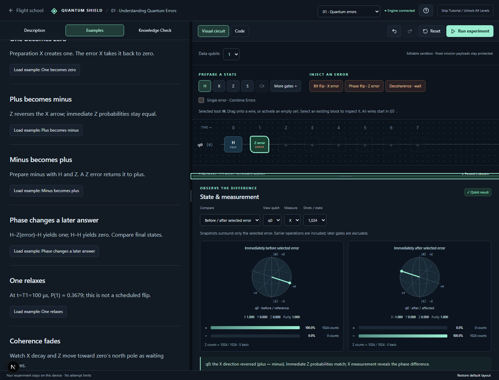

# Flight School 1 implementation

Implemented against `LEETCODE_WORKSPACE_AND_FLIGHT_SCHOOL_1.md`, with scope limited to the first module. Later modules retain their experiments, and the ten missions retain fixed payloads and existing scoring contracts.

## Run locally

Use the repository's existing Python environment and JavaScript installation:

```powershell
node scripts/dev.mjs
```

The Next.js app runs at `http://127.0.0.1:3000`, forwarding API calls to the Python service on port 8000. Open Flight school or Revisit the basics if an older pilot profile has already unlocked missions. Later modules also provide Revisit Flight School 1. No database, account, or new deployment service is required.

## Workspace and experiment

`LearningWorkspace.tsx` supplies independently scrolling panes, constrained pointer/keyboard splitters, a saved layout, and full-width Theory / Experiment / Results tabs below 1100 px. Only Flight School 1 mounts this shell. The scoped stylesheet is `src/app/noise-lab.css`.

The complete lesson includes the causes and circuit effects of X, Z, and T1/T2 decoherence, replayable transformations, a separate phase-drift illustration, eight editable presets, and the three-question knowledge check. Reduced motion shows transformation endpoints. Completion requires a successful simulation and all three correct answers; it enables the second module, not every mission. The existing explicit skip override still unlocks all missions.

The canvas supports 1–5 zero-initialized wires, 16 columns, 64 blocks, and up to eight errors in optional combination mode. Preparation gates are H/X/Y/Z/S/S†/RX/RY/RZ/CX. Errors have distinct roles and visuals. Use drag-and-drop or palette selection followed by an empty cell; keyboard Enter/Space also activates cells. Select blocks to inspect targets, columns, angles, or waiting parameters. Apply block changes commits parameter edits, including an entire slider gesture, as one undoable action. Delete through the inspector or Delete/Backspace with non-text focus. History retains 30 edits. Shrinking affected wires and replacing an existing isolated error require explicit confirmation.

Waiting is local to the named wire, with zero-temperature equilibrium. Elapsed t defaults to 50 μs (0–200), T1 to 100 μs (20–200), and T2 to 80 μs (positive, at most 2T1 and 400 μs). Columns do not add implicit waits. Preparation/readout are ideal.

Before/after mode captures only the selected error; final mode compares all preparation gates against the full circuit. Both branches report exact density-matrix-derived Bloch components and purity, exact basis probabilities, and independently displayed N-shot histograms. X measurement rotates copies before sampling. Marginals are derived from joint counts, with q0 at the right of outcome strings. A shared default seed 2026 gives reproducible simulator sampling. Resampling changes only samples. Stale results remain clearly labeled after edits; obsolete responses cannot replace newer work.

## Supported code and native export

The Code tab is editable. Source is parsed into the same bounded circuit model, not executed. The recognized declarations are `from quantum_shield import TutorialCircuit`, optional `from math import pi`, and `qc = TutorialCircuit(n)`. Supported calls mirror the preparation gates plus application helpers `bit_flip`, `phase_flip`, and `decoherence`. Optional `at=column` preserves parallel scheduling. Numeric literals and bounded arithmetic are allowed; arbitrary imports, dynamic calls, loops, definitions, attribute chains, and I/O are rejected with line/column diagnostics. The source is limited to 8 KiB, 128 lines, and 2048 AST nodes.

Apply Code replaces the draft atomically. Run in Code validates/applies that source before simulating, and invalid text is preserved. Switching to Visual with unapplied text requires Apply or Discard before conflicting edits. Native Qiskit export is a separate read-only standalone program using actual Qiskit gates and Aer thermal-relaxation instructions; it preserves comparison boundaries, basis, shot count, seed, units, and column barriers.

## Backend boundaries

`backend/noise_lab/models.py` validates roles, targets, parameters, occupancy, IDs and budgets. `code_parser.py` converts the allowlisted AST into those models. `simulator.py` performs Qiskit state preparation, local channel evolution, partial traces, purity/fidelity calculations and sampling.

| Endpoint | Request | Response |
| --- | --- | --- |
| POST `/api/tutorial/noise-lab/compile` | `code`, `combineErrors` | `circuit` and empty diagnostics, or null circuit and line/column diagnostics |
| POST `/api/tutorial/noise-lab/run` | `circuit`, `comparisonMode`, `selectedErrorId`, `basis`, `shots`, `sampleSeed` | State pair, labels, fingerprint, versions, global fidelity, parameters, explanations and duration |

Both endpoints share the existing 16 KiB request cap, simulation enable flag and single-compute admission guard. Run validates direct requests independently of Compile. No mission permission or request limit was widened. The former first-module endpoint remains compatible for existing API consumers; the new lesson uses only the isolated noise-lab endpoints.

## Persistence

Separate validated keys preserve mission profiles and personal bests:

- `quantum-shield.workspace.v1`: pane proportions.
- `quantum-shield.flight-school-1.draft.v1`: circuit, code/unapplied text, editor, selection, basis, shots, seed, comparison and selected qubit.
- `quantum-shield.flight-school-1.progress.v1`: `noise-basics-v1` content version, successful-run evidence, answers and completion.

An invalid draft resets only the sandbox; unavailable storage keeps session state with a notice. Global tutorial skip/completion state and mission results retain their existing key/schema.

## Verification

```powershell
.venv/Scripts/python.exe -m pytest tests -q
pnpm typecheck
pnpm test
# With Next.js and Python running:
pnpm test:e2e
# Stop the Next.js dev process before building:
pnpm build
```

The new Python regressions cover X/Z action, the Z-basis blind spot, H–Z–H propagation, zero waits, analytical T1/T2 evolution, ordering/cancellation, entanglement, five-wire endianness, joint/marginal consistency, seed invariance, parser rejection and API/mission isolation. Frontend tests cover bounds, role integrity, completion, zero Bloch vectors, all-preset code round-trips through the real parser, and executing native exports against canonical Qiskit density matrices. Set `PYTHON` to the desired interpreter if it is not in the project's `.venv`.

Browser journeys cover the complete existing six-module/mission flow and the new sandbox on desktop and mobile, including invalid-code preservation, keyboard placement, combinations, replacement/resize confirmation, undo/redo, stale requests, counts, basis switching, export and quiz retries. Screenshots are saved under `docs/screenshots/noise-lab-*.png` by the browser suite.

The project still needs its Python API running for simulations; the browser does not fabricate fallback quantum results. This change does not publish or deploy the application.

Verified on 15 October 2026 with Qiskit 2.5.2: **90 Python tests, 15 frontend tests, 10 desktop/mobile browser journeys, TypeScript validation, and the production build passed**. The production server's compile/run forwarding also returned the deterministic X-error result P(1)=1 with 1024/1024 counts. The error-focus adjustment was rechecked in both desktop/mobile sandbox journeys. Existing Starlette/httpx deprecation and Paulice basis-translation warnings do not fail the tests.


